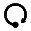

# Once icon

The mark is one solid dot and one arrow that leaves it, goes round, and comes
back to it. Each part of its shape has a reason:

- **The dot is the object 1, the unit.** A Once program is `main : 1 → 1`: it
  takes nothing, returns nothing, and means the effects along the way. The
  mark draws exactly that — an arrow from 1 back to 1, an endomorphism.
- **The arrow goes round once, with one arrowhead.** One stroke, drawn once:
  the name of the language. It also points at the quantity 1 in Once's type
  system: a value can be linear, used exactly once, alongside values that are
  not.
- **The path is a circle, so the mark is the letter O** of Once.
- **The line starts at the dot's centre** (a ball terminal), so the dot and
  the arrow read as one thing: the arrow leaves the object itself.
- **The dot is visibly heavier than the line**, so it reads as an object and
  not as the end of a line.
- **The arrowhead is symmetric**, with its tip and the centre of its back edge
  both on the circle, so it aims slightly inward, at the dot: the arrow is
  coming home.
